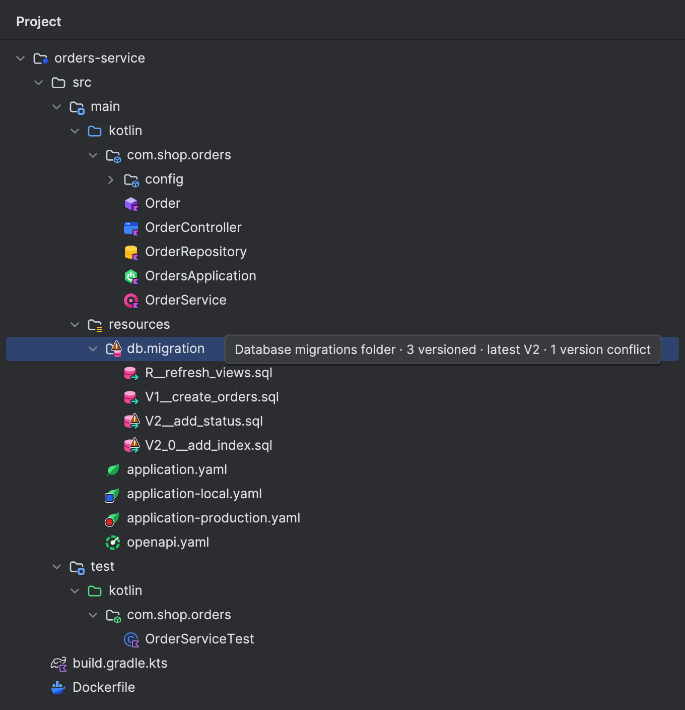
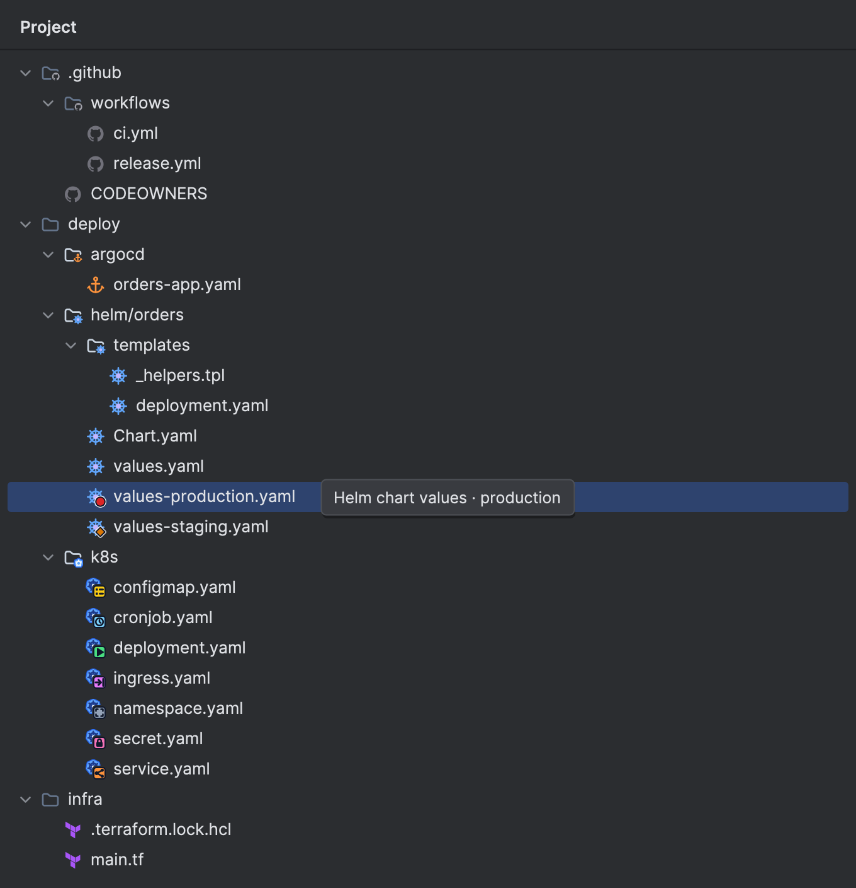
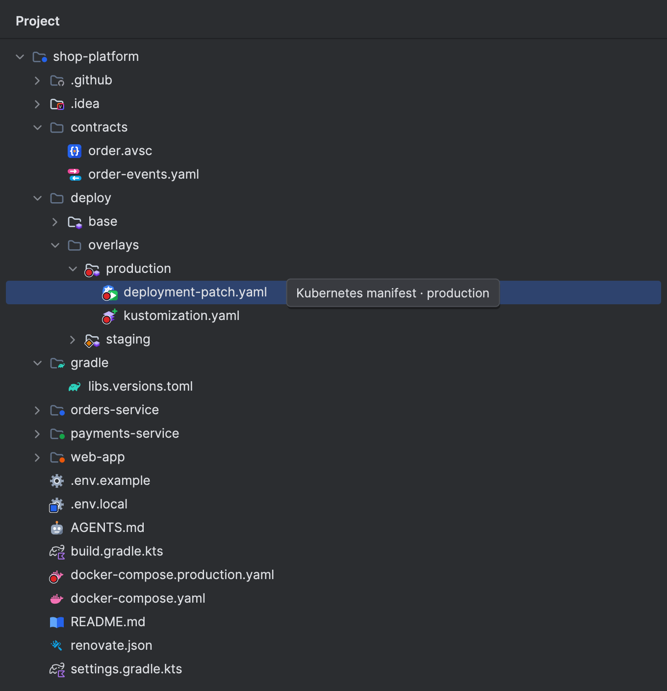

# Emberkai Icons

<picture>
  <source media="(prefers-color-scheme: dark)" srcset="src/main/resources/META-INF/pluginIcon_dark.svg">
  
</picture>

File and folder icons for JetBrains IDEs that also show what each file does and whether it needs your attention. More than 450 icons, all drawn in one faceted style as a companion to the Emberkai theme.

<table>
  <tr>
    <td><picture>
      <source media="(prefers-color-scheme: light)" srcset="design/screenshots/spring-service-light.png">
      
    </picture></td>
    <td><picture>
      <source media="(prefers-color-scheme: light)" srcset="design/screenshots/kubernetes-and-ci-light.png">
      
    </picture></td>
    <td><picture>
      <source media="(prefers-color-scheme: light)" srcset="design/screenshots/repository-overview-light.png">
      
    </picture></td>
  </tr>
</table>

## What you get

- **One icon set, one style.** File, folder, and tool icons share a flat body with a deeper facet, so a project never mixes a dozen icon styles. Java and Kotlin keep IntelliJ's own type icons and markers.
- **Class roles at a glance.** Spring, Quarkus, Micronaut, and JPA classes show their role in place of the letter in a circle: a window for a controller, an envelope for a message listener, an hourglass for a scheduled job, a cylinder for a repository, a cube for an entity, a flask for a test that starts the whole application. Next.js, NestJS, FastAPI, Flask, Django, and Celery files get the same roles as a small corner glyph.
- **Production stands out.** Production, staging, test, and local variants of Spring profiles, Compose files, Helm values, `.env` files, and environment folders get a shape-and-color badge, and production files open with a red editor tab and a banner.
- **Problems show up before review.** Secret files Git does not ignore, plaintext Kubernetes Secrets, duplicate Flyway versions, a stale `Chart.lock`, unpinned GitHub Actions and `latest` images, and config variants missing a key their siblings define each get a badge on the file.
- **Lenses that answer one question.** Dim the Project view down to the production blast radius, the entry points, what this branch changes, the last 90 days' hotspots, what a CODEOWNERS team owns, or the tests that are failing right now.
- **Recognized by content, not just name.** Kubernetes manifests by `kind`, Helm charts, Terraform and OpenTofu, Ansible, Argo CD and Flux, OpenAPI and AsyncAPI contracts, Flyway and Liquibase migrations, and dozens of CI and developer tools.

## Reading the icons

Each corner of a 16px icon means one thing and shows at most one mark:

| Corner | Means | Examples |
| --- | --- | --- |
| Top-left | What a TypeScript, JavaScript, or Python source file does | square web controller, envelope listener, ring service, cube entity |
| Top-right | Something to act on, or live now; the most urgent wins | red stop sign for an unignored secret, amber triangle for a warning, ring for a running service or active profile, dot for the module accent |
| Bottom-left | The environment | red circle production, amber diamond staging, green triangle test, blue square local |
| Bottom-right | Part of the artwork | Kubernetes kinds, folder glyphs, Spring Modulith locks |

**View > Emberkai Icons > Icon Legend…** shows every mark with its meaning. Right-click a file or an editor tab and choose **Explain This Icon** to see what its marks mean and which rule chose it.

## Install

In a JetBrains IDE, version 2026.1 or later, open **Settings > Plugins > Marketplace**, search for **Emberkai Icons**, and install it. The first project you open afterwards offers to keep just the icons or turn everything on; **Settings > Appearance & Behavior > Emberkai Icons** changes that at any time.

To install a particular build, download its ZIP from [Releases](https://github.com/khopland/idea-emberkai-icons/releases) and choose **Settings > Plugins > ⚙️ > Install Plugin from Disk…**. If Symbols Icons is installed, disable it so the two do not compete for the same files.

## Learn more

- [Reference](docs/reference.md): every icon, badge, lens, scope, and setting, and how each is detected.
- [Contributing](docs/contributing.md): building the plugin, adding a tool or a badge, and how the artwork is generated and checked.
- [Releasing](docs/releasing.md): how a version reaches GitHub and JetBrains Marketplace.
- [Changelog](CHANGELOG.md)

## Credits and license

MIT licensed. The base file and folder associations, and the subjects of the icons in `emberkai/icons/originals/`, come from [vscode-symbols](https://github.com/miguelsolorio/vscode-symbols) by Miguel Solorio; its MIT notice is in [licenses](licenses/vscode-symbols-LICENSE.txt). No Symbols artwork is bundled. Custom artwork in `emberkai/icons/` — including Ansible, Azure Pipelines, Bitbucket, Argo CD, Flux, and infrastructure symbols — is original Emberkai artwork drawn in the Emberkai palette. This project started from [Symbols Icons](https://github.com/joansgarcia/jetbrains-symbols).
